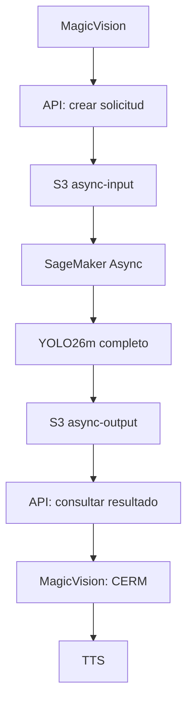

# MagicVision: YOLO26m en SageMaker Asynchronous Inference

## Estado y alcance

El modelo completo ya está entrenado. Este flujo solo empaqueta y sirve el checkpoint; no usa TFLite, no ejecuta YOLO en Android ni crea trabajos de entrenamiento.

El flujo Async está en scripts/aws/. La plantilla backend/api-template.yaml despliega la API móvil usando un endpoint Async y un rol Lambda existentes. backend/lambda/api.py selecciona el protocolo mediante INFERENCE_MODE=async; Flutter admite HTTP 202, consulta por trabajo y cancelación. backend/template.yaml es la plantilla síncrona histórica: **no desplegarla para obtener Async**.

Arquitectura implementada:



La app nunca recibe claves IAM ni URLs S3. La API restringe el acceso al CIDR público del laboratorio; no implementa cuentas de usuario individuales. Carga el JPEG, llama InvokeEndpointAsync y entrega un job_id aleatorio, separado del request_id. La consulta valida las diez clases, geometría, dimensiones y caducidad antes de entregar detecciones a CERM. Antes de capturar una escena, Flutter prepara el endpoint con un JPEG sintético y espera hasta 15 minutos. Cada llamada HTTP conserva un límite de 10 segundos; la captura posterior caduca a los 15 segundos en la app y a los 30 en el backend.

## 1. Inventario antes de modificar

| Elemento | Encontrado |
|---|---|
| Checkpoint | runs/detect/modelo_final_yolo26m_80e_640_b8/weights/best.pt |
| Clases canónicas | ml/configs/classes.txt; copia histórica assets/models/labels.txt |
| Paquete existente | backend/artifacts/model.tar.gz; best.pt, labels.txt, config.json en la raíz |
| Empaquetador | backend/package_model.py; no sobrescribe paquetes existentes |
| Serving | backend/sagemaker/serve.py; /ping, /invocations, puerto 8080, una carga de YOLO |
| Docker/dependencias | backend/sagemaker/Dockerfile y requirements.txt; inicialmente CPU |
| API | backend/lambda/api.py, schema.py, requirements.txt; HTTPS multipart síncrono |
| Infraestructura | backend/template.yaml; SageMaker síncrono y API Gateway/Lambda |
| Scripts AWS anteriores | No existían en scripts/aws/ |
| Configuración | .env.example; no se encontró .env real en el proyecto |
| Documentación anterior | docs/AWS_DEPLOYMENT.md, VALIDACION.md, MIGRACION_AWS_UVC.md |

Faltaban AsyncInferenceConfig, GPU/CUDA, cuota regional, escalado a cero y reactivación, confirmación del endpoint, prueba Docker real, publicación y scripts idempotentes.

Cambios iniciales: Docker CUDA, empaquetado, scripts AWS y pruebas del modelo. Respaldo: D:/Escritorio/Tesis/respaldo_pre_async_aws_20260909. Integración posterior: trabajos temporales en S3, API Gateway/Lambda, cliente Flutter, preparación y cancelación. Respaldo de esa integración: D:/Escritorio/Respaldo_MagicVision_integracion_async_20260909. Pesos, datasets y reglas CERM se conservan.

## 2. Requisitos, autenticación y región

Windows PowerShell 5.1 o PowerShell 7, Python 3.11+, Docker Desktop con motor Linux y AWS CLI v2. Configurar AWS CLI fuera del repositorio con el método que proporcione el laboratorio. Si utiliza IAM Identity Center, configurar el perfil SSO y ejecutar aws sso login --profile PERFIL. Para sesiones temporales del laboratorio, seguir sus instrucciones; no pegar credenciales en código, archivos del proyecto o chats.

Instalación oficial: [AWS CLI v2 Windows](https://docs.aws.amazon.com/cli/latest/userguide/getting-started-install.html).
Autenticación: [AWS CLI y métodos de acceso](https://docs.aws.amazon.com/cli/latest/userguide/cli-chap-authentication.html).

```powershell
aws --version
docker --version
aws configure get region
aws sts get-caller-identity
# Si se usa un perfil:
$env:AWS_PROFILE = 'perfil-del-laboratorio'
# Solo con la región realmente asignada:
$env:AWS_REGION = 'REGION_ASIGNADA'
.\scripts\aws\check-environment.ps1
```

Los scripts priorizan AWS_REGION/AWS_DEFAULT_REGION y luego la configuración del perfil CLI. La cuenta se obtiene de STS. **Sin autenticación o región, se detiene el despliegue.** No se elige una región de ejemplo. Los nombres de región/cuenta presentes en tests son ficticios y solo se usan en pruebas sin red.

Preparar dependencias locales en un entorno virtual:

```powershell
python -m venv backend/.venv
backend/.venv/Scripts/python -m pip install -r scripts/aws/requirements-test.txt
$env:MV_PYTHON = (Resolve-Path 'backend/.venv/Scripts/python.exe').Path
```

## 3. Configuración central

scripts/aws/config.ps1 contiene las variables. Se pueden sobrescribir mediante variables del proceso PowerShell, sin editar archivos:

| Variable | Valor predeterminado |
|---|---|
| AWS_REGION | Región configurada; sin valor inventado |
| AWS_ACCOUNT_ID | STS; no se acepta como credencial/configuración manual |
| MV_S3_BUCKET | magicvision-ACCOUNT_ID-REGION |
| MV_ECR_REPOSITORY | magicvision-yolo26m |
| MV_MODEL_NAME | magicvision-yolo26m |
| MV_ENDPOINT_CONFIG_NAME | magicvision-yolo26m-async |
| MV_ENDPOINT_NAME | magicvision-yolo26m-async |
| MV_INSTANCE_TYPE | ml.g4dn.xlarge, propuesta sujeta a cuota y confirmación |
| MV_EXECUTION_ROLE_ARN | Rol aprobado; descubrimiento si existe uno inequívoco |
| MV_TORCH_FLAVOR | cu118; cpu solo para una instancia CPU elegida explícitamente |
| MV_LOCAL_DEVICE | cpu; cuda para una prueba local adicional con NVIDIA Container Toolkit/WSL GPU |
| MV_TEST_IMAGE | Ruta opcional de una escena JPEG autorizada; sin valor usa imagen sintética |
| MV_PYTHON | python o ruta al Python del entorno virtual |

.env.example sigue siendo exclusivamente la configuración Flutter. Estos scripts no cargan .env ni guardan credenciales. backend/artifacts/aws/resolved-config.json contiene parámetros no secretos de la última sesión, como evidencia; no sustituye la validación STS en cada ejecución.

## 4. Paquete del modelo

```powershell
.\scripts\aws\package-model.ps1
tar -tzf backend/artifacts/model.tar.gz
```

Contenido exacto:

```text
best.pt
labels.txt
config.json
```

Se comprueba el SHA-256 del peso empaquetado contra el best.pt original, las clases y los parámetros. Si un paquete existente difiere, el script se detiene sin sobrescribir. El contenedor recibe MODEL_PATH=/opt/ml/model/best.pt y carga una vez con Ultralytics; labels/config se leen del mismo directorio. La imagen Docker excluye los pesos.

Clases: person, car, motorcycle, bus, bicycle, stairs, pothole, pole, traffic_sign, obstacle. Parámetros preservados: imgsz=640, confidence=0.30, iou=0.65, max_det=100.

## 5. Docker Linux amd64 y prueba obligatoria

```powershell
.\scripts\aws\build-docker.ps1
.\scripts\aws\test-docker.ps1
```

La receta fija PyTorch 2.7.1/torchvision 0.22.1 con CUDA 11.8, Ultralytics 8.4.56 y Python 3.11. CUDA 11.8 se eligió para la T4 de `ml.g4dn.xlarge` con el driver 470.x reportado: NVIDIA admite compatibilidad menor dentro de CUDA 11.x a partir del driver Linux 450.80.02. MODEL_DEVICE=auto selecciona CUDA si está disponible; cpu fuerza CPU para prueba local; cuda exige CUDA y falla al iniciar si no está disponible. SageMaker GPU usa cuda para evitar que un despliegue GPU defectuoso se presente como validado.

El test arranca un contenedor real con el paquete extraído montado de solo lectura, puerto aleatorio en 127.0.0.1, comprueba /ping y envía bytes JPEG a /invocations. Valida MIME, dimensiones, tiempos, labels, scores y cajas finitas normalizadas. Conserva local-result.json y docker-tested.json; este último vincula la prueba al ID de imagen, SHA del modelo y hashes de los archivos de serving. Un cambio obliga a repetirla antes de crear/subir recursos AWS.

El test local usa CPU incluso dentro de la imagen CUDA y no demuestra ejecución GPU. La comprobación GPU se hace en /ping/logs de SageMaker. `best.pt` sí fue cargado y ejecutado de forma aislada con PyTorch 2.7.1 CPU antes de preparar la entrega cu118; esto valida la compatibilidad del checkpoint, no la del runtime CUDA ni la latencia. test.jpg predeterminado es sintético: sirve para el contrato, no para medir precisión. Para usar una escena real autorizada:

Si Docker tiene acceso a una GPU NVIDIA local, se puede repetir con `$env:MV_LOCAL_DEVICE = 'cuda'`; el script añade `--gpus all` y exige que `/ping` informe CUDA. Esto tampoco sustituye la verificación en la instancia AWS.

```powershell
$env:MV_TEST_IMAGE = 'C:\ruta\escena-autorizada.jpg'
.\scripts\aws\test-docker.ps1
```

El JPEG se orienta, reduce a 640x640 conservando proporción y comprime a calidad 80. No se usa automáticamente una imagen del dataset para subirla a AWS.

Contrato: GET /ping responde 200 después de cargar el modelo; POST /invocations acepta image/jpeg hasta 2 MiB y 1280x720. Siempre responde JSON, incluidos errores 413/415/422/500. Las cajas usan las dimensiones de la imagen orientada, no del tensor letterbox.

```json
{"processing_time_ms":145,"image_width":640,"image_height":480,"detections":[{"class_id":0,"label":"person","confidence":0.87,"bbox":{"left":0.25,"top":0.18,"right":0.61,"bottom":0.93}}]}
```

detections puede ser []; un error no devuelve una escena vacía exitosa.

## 6. S3 privado y ECR

```powershell
.\scripts\aws\create-s3.ps1
.\scripts\aws\upload-model.ps1
.\scripts\aws\create-ecr.ps1
.\scripts\aws\push-ecr.ps1
```

S3 comprueba propietario y región, mantiene Block Public Access completo y utiliza SSE-S3. Si un bucket existente requiere KMS, se detiene para adaptar permisos a su clave, sin sustituir silenciosamente el cifrado.

Objetos/prefijos:

- models/yolo26m/model.tar.gz
- async-input/
- async-output/
- async-failure/

S3 no necesita carpetas reales; se crean marcadores vacíos. No se sobrescribe un modelo distinto en la misma clave. En ECR se crea el repositorio si falta, con etiquetas inmutables; se reutiliza latest solo si se demuestra que corresponde a la imagen probada. Para una nueva versión, elegir nuevos nombres/repositorio/bucket explícitamente. No se destruyen recursos para resolver conflictos.

El login ECR viaja por stdin y utiliza una configuración Docker temporal fuera del proyecto, eliminada al terminar. La imagen se publica como latest y SageMaker la referencia por digest, para que un cambio de etiqueta no cambie el contenedor desplegado.

## 7. IAM y restricciones educativas

Primero se consulta el rol indicado o se buscan roles cuya confianza incluya sagemaker.amazonaws.com. Si hay varios candidatos, indicar el ARN aprobado mediante MV_EXECUTION_ROLE_ARN. Verificar la confianza no prueba todas las políticas, condiciones o SCP; las operaciones AWS siguen siendo la comprobación definitiva.

No se crean roles ni se adjuntan políticas automáticamente. Si falta un rol, se generan propuestas revisables execution-role-policy.json y execution-role-trust.json para el administrador:

- GetObject sobre el modelo y async-input del bucket del proyecto.
- PutObject sobre async-output y async-failure.
- ListBucket restringido por prefijos, GetBucketLocation.
- Lectura del repositorio ECR exacto; GetAuthorizationToken requiere Resource=*.
- Escritura en el grupo de logs del endpoint.
- PutMetricData limitado al namespace AWS/SageMaker.

El rol de ejecución no necesita crear endpoints ni entrenar. La identidad que despliega necesita las operaciones S3/ECR/SageMaker de los scripts, consultas IAM/cuotas y iam:PassRole sobre el rol aprobado. Auto Scaling necesita sus operaciones, alarmas CloudWatch y el service-linked role de SageMaker Application Auto Scaling. Si falta este último y el laboratorio restringe su creación, pedir que el administrador lo provisione.

Cada error CLI conserva el comando, error AWS completo y JSON solicitado en backend/artifacts/aws/last-error.txt, con el servicio/operación y texto para el administrador. AccessDenied nunca se interpreta como “recurso inexistente”. No se aumenta ningún privilegio.

Ejemplo de solicitud al administrador, sustituyendo solo datos verificados:

> Necesito desplegar MagicVision YOLO26m exclusivamente para inferencia asíncrona en mi cuenta y región asignadas. Por favor, proporcione el ARN del SageMaker Execution Role aprobado, con confianza en sagemaker.amazonaws.com y acceso limitado al bucket, repositorio ECR y logs MagicVision. Necesito iam:PassRole limitado a ese rol, cuota disponible de una instancia ml.g4dn.xlarge para endpoint usage, y Application Auto Scaling con límites 0..1 y alarma CloudWatch. Adjunto el comando y error completos de last-error.txt. No solicito AdministratorAccess ni permisos de entrenamiento.

## 8. SageMaker Model y EndpointConfig

```powershell
.\scripts\aws\create-model.ps1
.\scripts\aws\create-endpoint-config.ps1
```

Se comprueba existencia y configuración antes de crear. Describe puede añadir metadatos/defaults, pero todo parámetro solicitado debe coincidir. Los modelos/configuraciones existentes que difieran requieren nombres nuevos.

La cuota se obtiene de Service Quotas en la región autenticada y se compara con el uso observado de endpoints. Se muestran otras cuotas de endpoint >=1 sin seleccionarlas. Tener cuota no demuestra permisos IAM, soporte Async específico o capacidad física libre; AWS valida esos puntos al crear el recurso. No hay fallback automático a una instancia más cara. Configuraciones heterogéneas existentes impiden calcular automáticamente el consumo y requieren revisión.

EndpointConfig incluye InitialInstanceCount=1, una variante AllTraffic, MaxConcurrentInvocationsPerInstance=1 y rutas S3 de éxito/fallo. No utiliza Serverless.

## 9. Confirmación antes del endpoint

```powershell
.\scripts\aws\create-endpoint.ps1
```

El script muestra cuenta, región, instancia y nombre reales y solicita escribir CREAR seguido de esos valores. Sin esa respuesta no llama CreateEndpoint. No existe opción de aceptación automática. La misma protección aplica al flujo completo deploy.ps1 y a CPU, porque también factura.

**No se debe confirmar desde un agente sin la autorización del usuario.** Si el endpoint ya existe con la misma configuración, se consulta su estado sin recrearlo; si difiere, se detiene. Los fallos/capacidad insuficiente muestran FailureReason sin cambiar instancia ni borrar el recurso.

## 10. Auto Scaling a cero

```powershell
.\scripts\aws\configure-autoscaling.ps1
```

Configura y verifica MinCapacity=0, MaxCapacity=1. Usa target tracking de ApproximateBacklogSizePerInstance y una política StepScaling/alarma HasBacklogWithoutCapacity para despertar con una solicitud. No basta con establecer MinCapacity=0 sin política de demanda.

**COLD START:** si no hay instancia, el JPEG queda en cola mientras se reactiva y carga el modelo. No se promete una latencia fija; medir la demora total por separado del tiempo del modelo. La instancia inicial, el arranque y el tiempo ocioso hasta scale-in también facturan. S3/ECR/logs conservan almacenamiento aunque el endpoint llegue a cero.

Si Auto Scaling falla, deploy.ps1 advierte que el endpoint puede seguir encendido; no lo destruye sin confirmación. Resolver el permiso o usar destroy-endpoint.ps1 explícitamente. Verificar posteriormente que CurrentInstanceCount llega a 0 y que una nueva solicitud reactiva el endpoint.

## 11. Primera inferencia y logs

```powershell
.\scripts\aws\test-async-inference.ps1
.\scripts\aws\cloudwatch.ps1
```

Sube test.jpg a async-input/UUID/test.jpg para evitar colisiones, invoca InvokeEndpointAsync y conserva InferenceId, OutputLocation y FailureLocation. Espera hasta una hora con sondeos de 15 segundos; un timeout no cancela ni elimina el trabajo AWS. Descarga y valida el JSON o muestra el objeto de fallo. Los archivos UUID-measurement.json registran tiempo total y processing_time_ms.

CloudWatch: /aws/sagemaker/Endpoints/NOMBRE_ENDPOINT. Los eventos estructurados son startup, model_loaded, request, inference_error y startup_error. Incluyen device, inference_time_ms y conteo de detecciones; no incluyen imágenes, credenciales o cuerpos de solicitudes. La verificación distingue logs de CPU/CUDA.

Para consulta manual:

```powershell
aws logs tail /aws/sagemaker/Endpoints/magicvision-yolo26m-async --since 1h --follow --region $env:AWS_REGION
aws sagemaker describe-endpoint --endpoint-name magicvision-yolo26m-async --region $env:AWS_REGION
```

## 12. Flujo completo y scripts

```powershell
.\deploy.ps1
```

Orden: check-environment y comprobación del rol/CIDR API → package-api → package-model → build-docker → test-docker → create-s3 → upload-model → create-ecr → push-ecr → create-model → create-endpoint-config → **confirmación** → create-endpoint → configure-autoscaling → test-async-inference → deploy-api. Consultar CloudWatch después de la inferencia.

## API móvil y configuración de Flutter

Antes del flujo completo, establecer MV_API_EXECUTION_ROLE_ARN con un rol existente que confíe en lambda.amazonaws.com, y MV_ALLOWED_CLIENT_CIDR con la salida pública autorizada del laboratorio (por ejemplo, su IPv4 con /32; no la IP privada del teléfono). MV_API_STACK_NAME tiene el valor inicial magicvision-async-api. No se crea ni amplía ningún rol automáticamente. La política propuesta se guarda en backend/artifacts/aws/proposed-api-role-policy.json para el administrador. El desplegador necesita permisos de CloudFormation, Lambda, API Gateway, CloudWatch Logs y iam:PassRole limitado a ese rol, además de configurar el ciclo de vida del bucket.

```powershell
# Empaquetado local Linux; no necesita AWS CLI ni cuenta.
.\scripts\aws\package-api.ps1
# Después de configurar la cuenta, crear/verificar el endpoint y sus permisos:
.\scripts\aws\deploy-api.ps1
.\scripts\aws\test-api.ps1
# Usa la URL HTTPS real que produjo CloudFormation, sin copiar claves.
flutter run --dart-define-from-file=backend/artifacts/flutter-cloud.json
flutter build apk --debug --target-platform android-arm64 --dart-define-from-file=backend/artifacts/flutter-cloud.json
```

La API procesa multipart como binario para conservar el JPEG. La Lambda solo recibe código/dependencias Linux; el modelo permanece en SageMaker. Un ZIP o código que cambió después de la validación bloquea el despliegue. Un stack existente con otro código, plantilla o parámetros se conserva y exige una versión/nombre nuevo o una actualización revisada. CloudFormation no hace rollback automático en esta receta. El nombre/URL reales quedan en backend/artifacts/aws/api-outputs.json. deploy-api verifica /health desde la red autorizada antes de generar flutter-cloud.json. test-api ejecuta el cliente Dart y CERM contra la URL real con un JPEG del dataset, sin claves AWS en Flutter. Esa prueba invoca el modelo y puede reactivar la instancia. No sustituye la prueba USB/TTS en el teléfono.

Protocolo:

| Operación | Respuesta |
|---|---|
| POST /v1/inference/warmup, request_id UUID | 202 y job_id; 200 ready al consultar cuando el modelo está listo |
| POST /v1/inference, request_id y image JPEG | 202 y job_id |
| GET /v1/inference/{job_id} | 202 processing, 200 detecciones, 410 caducado/cancelado, 5xx ante fallo |
| DELETE /v1/inference/{job_id} | 200 cancelled; el cliente deja de consultar y descarta respuestas tardías |

DELETE no detiene una ejecución ya iniciada dentro de SageMaker. El marcador de cancelación tiene prioridad sobre resultados concurrentes. Las imágenes se eliminan al consumir/cancelar el trabajo; los prefijos app-jobs/, async-input/app/, async-output/app/ y async-failure/app/ tienen expiración S3 de un día, incluidas versiones anteriores, para trabajos abandonados. S3 elimina de forma eventual, no exactamente al cumplirse el plazo. No se aplica retención a models/, api/ ni a los experimentos CLI. Los objetos de fallo se eliminan usando la ubicación exacta devuelta por SageMaker; comprobar en AWS si la ruta de fallo también incluye la extensión app.

Prueba local reproducible, con modelo real y transporte AWS/cámara simulados:

```powershell
.\backend\.venv\Scripts\python.exe -m pip install -r backend/testing/requirements.txt
.\backend\.venv\Scripts\python.exe backend/testing/run_integration.py
```

Requiere la imagen magicvision-yolo26m:latest, model.tar.gz, Flutter y GPU NVIDIA disponible en Docker. El certificado TLS es temporal y solo el cliente de prueba lo confía. No se modifica la validación HTTPS de producción. El informe separa expresamente modelo/API/Dart reales de AWS, USB y TTS audible no probados.

Cada etapa dispone de su .ps1 en scripts/aws/. common.ps1 pasa configuración no secreta al motor Python workflow.py; runtime.py ejecuta AWS CLI/Docker con argumentos separados y sin shell. Esto centraliza errores, validación e idempotencia y permite pruebas offline de los JSON contra los modelos oficiales de botocore.

## 13. Errores frecuentes

| Error | Acción |
|---|---|
| aws no encontrado | Instalar AWS CLI v2 y abrir una terminal con PATH actualizado |
| ExpiredToken / Unable to locate credentials | Renovar la sesión del laboratorio fuera del repositorio |
| Sin región | Pedir la región asignada y configurarla |
| Docker pipe/engine ausente | Iniciar Docker Desktop con contenedores Linux |
| /ping falla | Revisar logs locales, paquete montado y dependencia CUDA/CPU |
| JSON inválido | Detener publicación; comprobar labels, dimensiones y boxes |
| Quota 0 / ResourceLimitExceeded | Solicitar cuota para endpoint usage, sin cambiar instancia automáticamente |
| AccessDenied / iam:PassRole | Entregar last-error.txt al administrador |
| CUDA no disponible en GPU | Revisar imagen CUDA/driver de la instancia; no aceptar fallback CPU |
| Existing resource differs | Elegir una versión/nombre distinto, sin borrar el anterior |
| Auto Scaling denegado | Endpoint puede seguir facturando; solicitar permiso o eliminación explícita |
| S3 timeout / FailureLocation | Revisar el objeto de fallo y CloudWatch; no inventar detecciones |

## 14. Eliminación manual

```powershell
.\scripts\aws\destroy-endpoint.ps1
```

Pide escribir ELIMINAR y el nombre exacto. Solo entonces desregistra el target de Auto Scaling, elimina la alarma wake y el endpoint, y espera a verificar su eliminación. Nunca se llama desde deploy.ps1. Model, EndpointConfig, bucket y ECR quedan conservados; cada eliminación posterior debe revisarse y autorizarse de forma explícita. No hay comando que vacíe buckets o repositorios automáticamente.

## Fuentes oficiales

- [Contrato del contenedor SageMaker](https://docs.aws.amazon.com/sagemaker/latest/dg/your-algorithms-inference-code.html)
- [Crear un endpoint Async](https://docs.aws.amazon.com/sagemaker/latest/dg/async-inference-create-endpoint.html)
- [InvokeEndpointAsync](https://docs.aws.amazon.com/sagemaker/latest/dg/async-inference-invoke-endpoint.html)
- [Escalado a cero y reactivación](https://docs.aws.amazon.com/sagemaker/latest/dg/async-inference-autoscale.html)
- [Disponibilidad y problemas Async](https://docs.aws.amazon.com/sagemaker/latest/dg/async-inference-troubleshooting.html)
- [Multipart binario en API Gateway](https://docs.aws.amazon.com/apigateway/latest/developerguide/api-gateway-payload-encodings.html)
- [Expiración eventual de S3 y versiones](https://docs.aws.amazon.com/AmazonS3/latest/userguide/lifecycle-expire-general-considerations.html)
- [PyTorch: versiones y ruedas CUDA](https://pytorch.org/get-started/previous-versions/)
